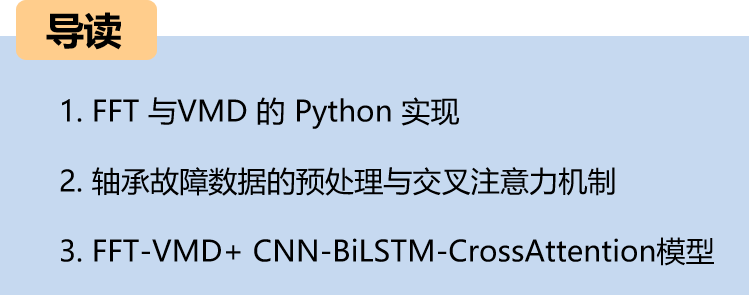
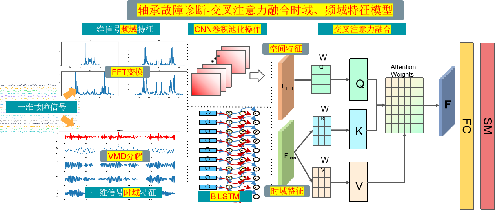
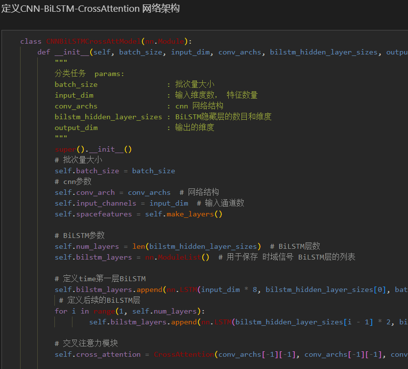
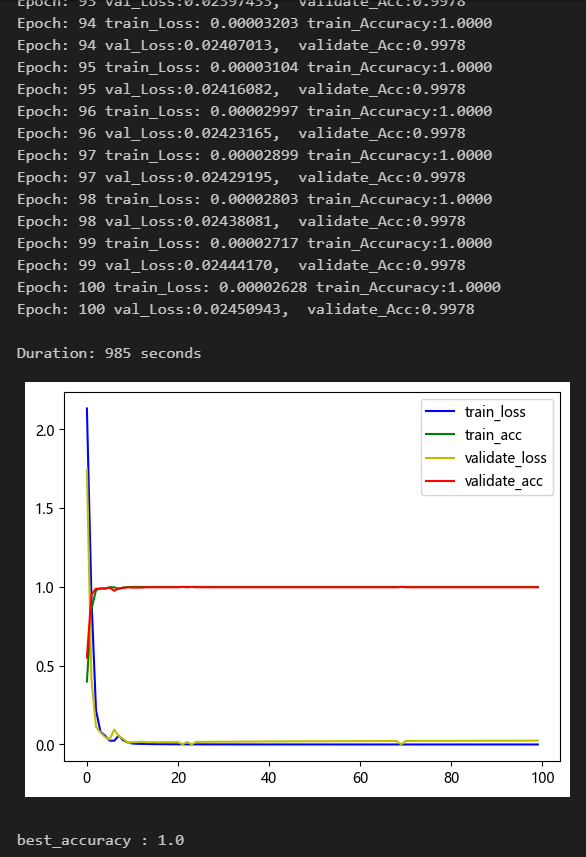
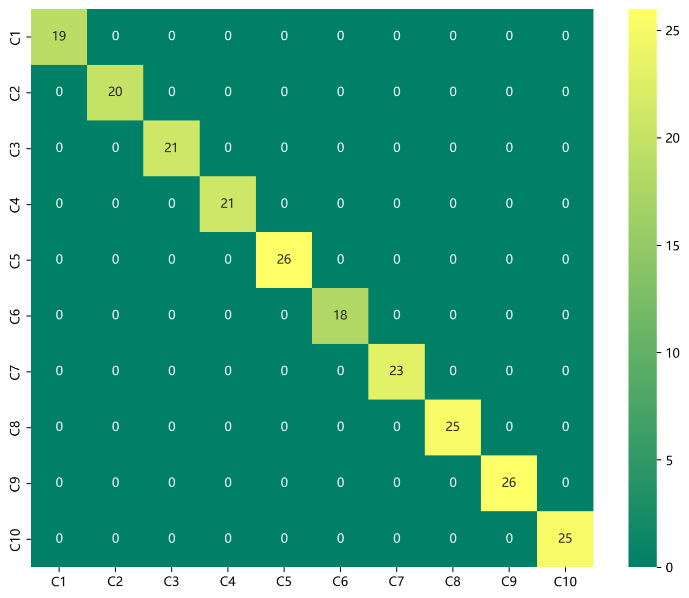
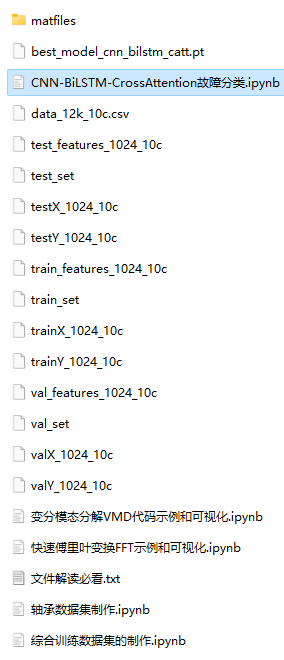
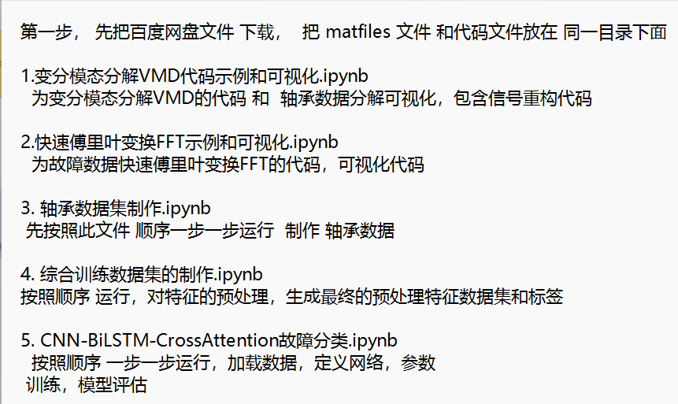

# Python Bearing Fault Diagnosis (14) High-Innovation Fault Identification Model

Recommendation - Family Pack, with higher cost-performance ratio! ● Data set: CWRU Western Reserve University bearing dataset, Harbin Institute of Technology Aerospace Engine Bearing dataset
● Environment framework: Python 3.9, PyTorch 1.8 and above versions can run
● Accuracy: 100% on test set
● Usage object: Paper requirements, graduation design requirements
● Code guarantee: Code comments are detailed, ready to run without modification.
Innovation points:
1. Preprocessing part: Combining Fast Fourier Transform (FFT) and Variational Mode Decomposition (VMD) for signal time-frequency and domain feature extraction, which can mine multi-scale features in fault signals;
2. Then using Convolutional Neural Network (CNN) to extract spatial features of multi-scale features after preprocessing fault signals, and Bidirectional Long Short-Term Memory (BiLSTM) to extract temporal features of multi-scale features after preprocessing fault signals;
3. Finally, cross attention is used to fuse spatiotemporal features, thereby improving the representation ability of features to achieve fault signal recognition, including complete bearing fault datasets, as well as generated fault signal datasets, classification data sets, and label sets, corresponding codes can be run, and there are also examples of FFT-VMD+CNN-BiLSTM-CrossAttention network classification
50 epochs, accuracy 100%, FFT-VMD+CNN-BiLSTM-CrossAttention network classification effect is significant, the model can fully extract spatial and temporal features and frequency domain features of bearing fault signals, converges quickly, has excellent performance, and is currently the highest precision method among previous articles. The innovation degree is also high!!!
Includes code for data preprocessing and FFT, VMD, CNN-BiLSTM-CrossAttention classification
Environment: Python 3.9
Preface
This article preprocesses the data for YOLOv8-based vehicle recognition using the bearing data from Case Western Reserve University (CWRU), focusing on Fast Fourier Transform (FFT) and Variational Mode Decomposition (VMD). The classification of faulty data is then implemented through a spatial-temporal feature fusion model based on Cross Attention, CNN-BiLSTM-CrossAttention. For a detailed introduction to CWRU's bearing data, please refer to the following:
Python-Case Western Reserve University (CWRU) Bearing Data Interpretation and Classification Processing
1. Overall Model Structure
\t1.1 The overall structure of the model is as follows:
\tThe one-dimensional fault signal is first transformed by FFT and then decomposed by VMD. The results of the decomposition are stacked, and features in both space and time domains are extracted by CNN and BiLSTM networks. Finally, the cross attention mechanism is used to fuse the features in time and frequency domains. By calculating attention weights, the model can focus more on important features, enhancing its performance and generalization capabilities.
\t1.2 In-depth introduction to innovation points:
\tWhen dealing with fault signals, extracting time-frequency domain features is crucial. Combining Fast Fourier Transform (FFT) and Variational Mode Decomposition (VMD) can effectively mine multi-scale features from the signal.
\t(1) Preprocessing - FFT:
\tFFT is a widely used method for frequency domain analysis, which converts signals from the time domain to the frequency domain to obtain the signal's spectral information. Through FFT, we can obtain the energy distribution of the signal at different frequencies, thereby understanding the frequency components of the signal. However, FFT only provides the spectral information of the signal at a certain moment, unable to reflect the change of the signal over time.
\t(2) Preprocessing - VMD:
To address this issue, Variational Mode Decomposition (VMD) can be introduced. VMD is a mode decomposition method based on signal adaptive adjustment, which can decompose the signal into a series of mode functions, each representing the characteristics of the signal at different scales. Through VMD, we can obtain the time-domain feature information of the signal at different scales.
(3) Preprocessing—Feature Fusion:  
Combining FFT and VMD, we can first use FFT to convert the signal into the frequency domain, obtaining the spectrum information of the signal. Then, simultaneously applying VMD to the fault signal, it can be decomposed into a series of mode functions. These mode functions represent the time-domain characteristics of the signal at different scales. By analyzing these information, we can mine the multi-scale features of the fault signal, thereby better understanding the time-frequency characteristics of the signal. This method can analyze signals more comprehensively, aiding in signal processing tasks such as fault detection and diagnosis. We fuse the multi-scale features extracted by FFT and VMD as input to an innovative network model for training.
(4) Innovative Network Model—CNN Spatial Feature Extraction:  
Input: Fused FFT, VMD features  
Operation: Convolution and pooling operations are performed on each input feature to extract spatial features  
Output: The convolutional pooling results, used to capture vibration spatial features at different frequencies  

(5) Innovative Network Model—BiLSTM Time Series Feature Extraction:  
Input: Fused FFT, VMD features  
Operation: A bidirectional LSTM network learns sequence information, focusing on important time-series features  
Output: The time-series feature representation processed by BiLSTM, with better fault signal time-series modeling capability  
(5) Multi-Scale Feature Fusion—Cross Attention Mechanism Feature Fusion:  
Input: The spatial features extracted by CNN, the time-series features extracted by BiLSTM
Cross Attention Mechanism: Utilizes the cross attention mechanism to fuse time-domain and frequency-domain features. By calculating attention weights, the model can focus more on important features, thereby enhancing model performance and generalization capabilities.
2 Preprocessing of Bearing Fault Data
2.1 Import Data
Referring to previous articles, preprocessing for fault classification into ten categories is carried out. The Case Western Reserve University bearing data set for fault classification into ten categories:
train_set, val_set, test_set are divided according to a ratio of 7:2:1 for training set, validation set, and test set, respectively, and the data is finally saved.
2.2 Fault FFT Transform Visualization
2.3 Fault VMD Decomposition Visualization
2.4 Preparation of Feature Dataset for Fault Data
3 Cross Attention Mechanism
3.1 Concept of Cross Attention
The cross attention mechanism in the transformer architecture involves a mechanism that mixes two different embedding sequences.
Both sequences must have the same dimensionality.
The two sequences can be of different patterns (e.g., text, sound, image).
One sequence acts as the input Q, defining the output sequence length, while the other provides input K&V.
3.2 Cross-attention Algorithm
Having two sequences S1 and S2,
Calculate S1's K, V
Calculate S2's Q
Based on K and Q calculate the attention matrix
Apply V to the attention matrix
Output sequence length consistent with S2
During the fusion process, we use spatial features obtained through CNN convolutional pooling operations as the query sequence, and the sequential features output by BiLSTM as key-value pairs. By calculating the attention weights between the query sequence and the key-value pairs sequence, we can model the degree of association between different features.
4 Bearing Fault Diagnosis Classification Based on FFT-VMD+CNN-BiLSTM-CrossAttention
4.1 Define the FFT-VMD+CNN-BiLSTM-CrossAttention classification network model
4.2 Set parameters and train the model
50 epochs, accuracy 100%, the FFT-VMD+CNN-BiLSTM-CrossAttention network achieves significant classification results. The Fast Fourier Transform (FFT) and Variational Mode Decomposition (VMD) can effectively mine multi-scale features from signals. The innovative model fully extracts spatial and temporal features of bearing fault signals, with fast convergence speed, superior performance, high accuracy, and cross attention mechanism capable of modeling the correlation degree between different features. It extracts important features from the frequency domain and time domain characteristics of fault signals, resulting in noticeable effects and a high level of innovation!
Note: Adjust parameters as needed:
- Increase the number of CNN layers and hidden layer dimensions, adjust learning rate;
- Adjust the number of BiLSTM layers and dimensions, increase more epochs (be cautious to prevent overfitting);
- Change the shape of one-dimensional signal stacking (set appropriate length and dimension);
4.3 Model evaluation
- Accuracy, Precision, Recall, F1 Score
- Fault classification confusion matrix:
\n        \n  


## Images

<!-- PAYMENT_BLOCK -->

## Get this dataset

- Payment link (Stripe): [Buy now](https://buy.stripe.com/3cs8yP7sY87d0vu9AB)
- Payment QR code: 

<!-- /PAYMENT_BLOCK -->
